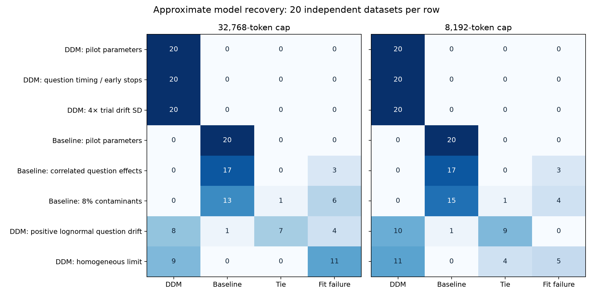

# Two-repeat design: realistic simulation screening

**The design is promising under the fitted model families, but reliable end-to-end Bayesian recovery has not been established. These results do not establish an accumulation mechanism or a validated power calculation for the full experiment.**

This extends the earlier, milder recovery simulations. Following [Wilson and Collins (2019)](https://elifesciences.org/articles/49547), recovery reports correct selections, opposite-family selections, inconclusive results and fitting failures, rather than counting every positive score as success. No model API calls were made.

## Design and what was fitted

160 independent simulated datasets, each with 400 questions × four conditions × two repeats (3,200 trials). Two paired views apply 32,768- and 8,192-token caps to the same underlying trials: 320 comparisons, not 320 independent datasets. The first six scenarios were specified in `results/design_recovery/plan.json`; two exploratory difficulty/parameter-regime checks were specified separately before their fits in `extensions_plan.json`. Correct-option position is balanced independently of repeat index. No positional bias was simulated.

Population hyperparameters are joint draws from the five saved R1 CV posteriors, with fresh question effects and trial noise; code prevalence is 44%. This incorporates uncertainty in fitted hypotheses, rather than fixing one convenient textbook parameter set. Question timing stress adds a common question delay (median 150 prose / 750 code tokens, log SD 0.7) and assigns independent early deadlines to 3.75% of trials; an assigned deadline yields an incomplete observation only if it actually interrupts the trace. Contaminants have lognormal length (median 2,000 tokens, log SD 2) and fair responses. Correlated baseline effects have correlation +0.6.

The primary batch uses **composite-likelihood population MAP**, fitting trial marginals and omitting within-question covariance from the fitting objective. Data retain that dependence; validation holds out entire questions, and SEs sum scores within questions. Predictions integrate population Normal effects. This is a fast screening approximation, **not the full hierarchical Bayesian fitting workflow** and not parameter recovery. It cannot identify the split between question and trial variance. Three grouped folds, two optimization starts, shared priors and the same score target are used for both models. Here joint means length and correctness for each trial, summed over held-out rows; it is not the joint probability of all eight outcomes of a question. Winner requires that score difference beyond two question-level SEs. Failed optimizations stay in the denominator. Length and correctness components, each with question-level SE, are saved alongside joint scores.

## Recovery outcomes

“Correct” means selection consistent with the generating family. In the timing, correlated-effects, contamination and positive-drift stresses, the fitted candidates need not include the exact generator; an opposite-family result illustrates the limits of a mechanism interpretation, rather than a mistake in choosing the best predictive approximation.

| Generator | Cap | Correct (95% Wilson interval) | Opposite family | Inconclusive | Fit failure |
| --- | ---: | ---: | ---: | ---: | ---: |
| DDM: pilot parameters | 32,768 | 20/20 (84%–100%) | 0/20 | 0/20 | 0/20 |
| DDM: pilot parameters | 8,192 | 20/20 (84%–100%) | 0/20 | 0/20 | 0/20 |
| DDM: question timing / early stops | 32,768 | 20/20 (84%–100%) | 0/20 | 0/20 | 0/20 |
| DDM: question timing / early stops | 8,192 | 20/20 (84%–100%) | 0/20 | 0/20 | 0/20 |
| DDM: 4× trial drift SD | 32,768 | 20/20 (84%–100%) | 0/20 | 0/20 | 0/20 |
| DDM: 4× trial drift SD | 8,192 | 20/20 (84%–100%) | 0/20 | 0/20 | 0/20 |
| Baseline: pilot parameters | 32,768 | 20/20 (84%–100%) | 0/20 | 0/20 | 0/20 |
| Baseline: pilot parameters | 8,192 | 20/20 (84%–100%) | 0/20 | 0/20 | 0/20 |
| Baseline: correlated question effects | 32,768 | 17/20 (64%–95%) | 0/20 | 0/20 | 3/20 |
| Baseline: correlated question effects | 8,192 | 17/20 (64%–95%) | 0/20 | 0/20 | 3/20 |
| Baseline: 8% contaminants | 32,768 | 13/20 (43%–82%) | 0/20 | 1/20 | 6/20 |
| Baseline: 8% contaminants | 8,192 | 15/20 (53%–89%) | 0/20 | 1/20 | 4/20 |
| DDM: positive lognormal question drift | 32,768 | 8/20 (22%–61%) | 1/20 | 7/20 | 4/20 |
| DDM: positive lognormal question drift | 8,192 | 10/20 (30%–70%) | 1/20 | 9/20 | 0/20 |
| DDM: homogeneous limit | 32,768 | 9/20 (26%–66%) | 0/20 | 0/20 | 11/20 |
| DDM: homogeneous limit | 8,192 | 11/20 (34%–74%) | 0/20 | 4/20 | 5/20 |



Twenty successes out of twenty give an interval of 83.9%–100%. Zero opposite-family selections out of twenty still permit a rate as high as 16.1% at the 95% Wilson limit; they do not certify a false-selection rate below 5%. Caps are paired and must not be pooled as independent repetitions. These intervals describe simulation variation conditional on these generators and this screening method, not uncertainty about all possible LLM behavior.

## Calibration and confirmation limits

The generators are calibrated to **fitted parameter hypotheses**, not exact reproductions of R1. At the historical 8,192 cap, R1 has 42.8% censored rows and 95.6% accuracy among answers. The table shows means over the 20 simulations; full replicate statistics are saved in `observable_calibration.csv`.

| Generator | Censored at 8,192 | Answered accuracy |
| --- | ---: | ---: |
| DDM: pilot parameters | 25.4% | 87.0% |
| DDM: question timing / early stops | 28.9% | 86.0% |
| DDM: 4× trial drift SD | 22.5% | 84.0% |
| Baseline: pilot parameters | 38.6% | 91.6% |
| Baseline: correlated question effects | 38.4% | 89.9% |
| Baseline: 8% contaminants | 35.6% | 87.1% |

Therefore favorable exact-family recovery cannot by itself establish power for the actual data-generating process. Positive lognormal question drift specifically tests the Normal latent-difficulty assumption; the homogeneous limit fixes question drift SD to 0.08, trial drift SD to zero and contamination to zero, and is a deliberate boundary case rather than an R1 estimate.

Selected hierarchical MAP confirmations: 6 complete comparisons, 5 passing the fit flag, 5 agreeing with the composite selection among passing checks. See `hierarchical_confirmation.csv`; missing confirmations are not counted as successes. Completed Bayesian attempts and their convergence flags are recorded in `bayesian_diagnostics.csv`. Full Bayesian confirmations are incomplete, and some completed attempts fail the Rhat/ESS criteria. Dense-mass refinements have separate checkpoints. Their raw scores must not be presented as validated recovery rates.

Numerical checks compare the simulator CDF, independent likelihood implementations, direct adaptive integration, gradients and all option schedules. The selected direct-integration checks differ by at most about 0.0003 nats; the simulator check has a maximum empirical CDF discrepancy of 1.03 percentage points at 20,000 draws and time step 0.005. The simulation's infinite latent-time sentinel means “not resolved before the maximum simulated deadline,” not a literally infinite decision time. Numerical pilot approximations that failed validation were archived and excluded from the recovery rates.

## Decision

In the 32,768-cap screen, the two calibrated families each recover in 20/20 datasets. Positive lognormal question drift recovers in only 8/20; this generator changes the latent difficulty distribution while retaining a DDM decision process. That is a direct warning about interpreting model preference as mechanism evidence. Fitting failures in the homogeneous limit are computational failures, and should not be relabeled as statistical indistinguishability.

Keep the modeling idea, but **do not claim that the proposed experiment is already validated for reliable Bayesian discrimination**. The simulation screen establishes conditional distinguishability of statistical families. Before launching the full collection, complete diagnostic-passing Bayesian recovery on realistic repeated datasets, examine the observed-versus-simulated discrepancies, and check alternative difficulty/outlier assumptions. A DDM victory establishes neither unique drift variability nor an internal accumulation mechanism.

## Reproduction and artifacts

Run from the repository root:

```bash
.venv/bin/python scripts/12_design_recovery.py --stage generate
.venv/bin/python scripts/12_design_recovery.py --stage generate --profile ddm_lognormal_questions
.venv/bin/python scripts/12_design_recovery.py --stage generate --profile ddm_low_variation
.venv/bin/python scripts/13_validate_design_recovery.py
.venv/bin/python scripts/14_recovery_screen.py
.venv/bin/python scripts/16_report_design_recovery.py
```

`12_design_recovery.py --rep 0 --profile ...` runs the more expensive hierarchical MAP check. `15_bayesian_design_recovery.py --profile ddm_calibrated` (or `baseline_calibrated`) runs Bayesian confirmation; it is checkpointed separately and may require further diagnostic refinement. Previously started `12_power_simulation.py` experiments under `results/power` are separate Bayesian checks, not independent replications of this batch; incomplete or diagnostic-failing comparisons must not be pooled into these rates.

[Comparison scores and question-level uncertainty](../results/design_recovery/composite/comparisons.csv), [recovery counts and intervals](../results/design_recovery/composite/recovery_rates.json), [observable calibration](../results/design_recovery/observable_calibration.csv), [numerical checks](../results/design_recovery/numerical_validation.json), [hierarchical confirmations](../results/design_recovery/hierarchical_confirmation.csv), [Bayesian diagnostics](../results/design_recovery/bayesian_diagnostics.csv). Generator metadata, source posterior hashes, per-fold parameters, diagnostics and per-trial scores are preserved under `results/design_recovery`.
