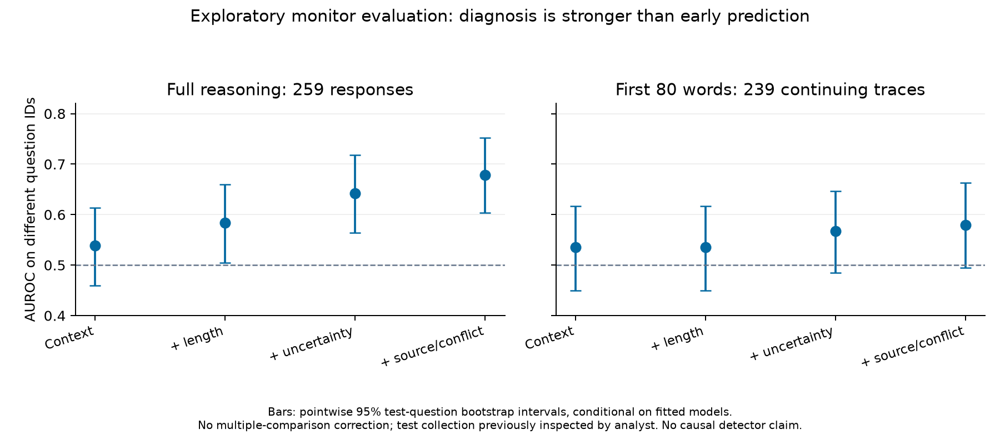

# Can Reasoning Text Predict Wrong Key Following

Offline feasibility study completed on 2026-10-19. The combined text features provide a moderate end-of-trace prediction signal on new question IDs. An 80-word prefix does not yet show a clear gain over contextual prediction. This is exploratory prediction of observed benchmark errors, not a validated detector of causal influence or harmful real-world behavior.

## Prior work and the specific question

Text-based prediction of error is established: [Vanhoyweghen et al. 2025](https://arxiv.org/abs/2508.15842) examine lexical uncertainty and reasoning length. [Chan et al. 2025](https://arxiv.org/abs/2507.12428) study prediction before reasoning ends, comparing text and activation-based methods. Our hosted-model data contain returned reasoning text but no internal activations, so we cannot reproduce their strongest method.

[Duzan and Cooper Stickland 2026](https://arxiv.org/abs/2608.04735) distinguish explicit and implicit influence when assessing monitoring reliability. [Bürger et al. 2026](https://arxiv.org/abs/2610.18105) show that requiring reasoning does not guarantee monitorability. These findings make prediction, causal detection, and effective intervention separate research targets.

The project-specific question is whether simple uncertainty, source-conflict, and task-language features transfer from the completed wording collection to different questions in the paused collection, and how much of that signal is available early.

## Data and evaluation

The [analysis plan](THREE_DIRECTION_ANALYSIS_PLAN.md) preceded the new fit and evaluation, but the analyst had already seen treatment-effect summaries and selected explanations from both collections. This is a new-question evaluation, not an untouched confirmatory test.

Training uses 1,195 answered frequency/probability hinted responses across 100 completed-study questions. Test data contain 259 answered wrong-key responses across 171 paused-study questions. There is no overlap in question IDs or normalized question texts. The label is whether the final answer follows the supplied wrong key, equivalent here to disagreement with the benchmark answer. An independent no-key response is not required for this label, so it cannot distinguish an ordinary factual error from an error caused by the key.

Four fixed logistic regressions use nested feature sets: context alone (model, wording, claimed reliability); context plus available-text word length; those features plus lexical uncertainty; and a combined model adding source mentions, conflict terms, task-language terms, rejection terms, and endorsement terms. Final completion text, chosen answer, ground truth, hint letter, question ID, and scored outcomes are excluded from inputs. The fixed regularization has no test-set search. Training cross-validation groups all responses from the same normalized question together, fitting preprocessing within each fold.

The full-trace model receives the complete returned reasoning and is an end-of-trace diagnostic. The prefix model is separately trained on the first 80 whitespace-delimited words, using only traces longer than 80 words. It receives no future length. That leaves 1,025 training responses and 239 test responses; the 20 excluded test responses are short gpt-oss traces. Thus the prefix result applies to continuing traces, not every response, and words are not model tokens.

## New question results

AUROC measures whether a randomly selected wrong-key-following response receives a higher score than a non-following response; 0.5 is chance ranking. It is not percent accuracy.

| Features | Full-trace AUROC | First-80-word AUROC |
| --- | ---: | ---: |
| Context | 0.539 | 0.535 |
| Context and length | 0.583 | 0.535 |
| Context, length, uncertainty | 0.642 | 0.567 |
| Combined source and conflict features | 0.679 | 0.580 |

For the combined full-trace model, the pointwise 95% question-bootstrap AUROC interval is 0.604–0.752; its difference from context-only ranking is +0.045 to +0.239. Brier score, where lower is better, improves from 0.241 to 0.213. These intervals resample test questions conditional on the fitted model and do not include variation from retraining or multiple-comparison correction. They do not establish the incremental value of source-language features over uncertainty features alone.

For the combined prefix model, the AUROC interval is 0.495–0.663 and its difference from contextual ranking spans −0.042 to +0.133. Its Brier score is worse than the contextual baseline, 0.241 versus 0.234. There is no clear pooled early-warning improvement in this evaluation.

At a fixed review budget of the highest-scoring 20% of full-trace responses, the combined model flags 52 responses and catches 35 of 91 wrong-key-following answers: 67.3% precision and 38.5% recall. It also flags 17 resistant answers and misses 56 wrong-key-following answers. These are observed review-budget descriptions, not an intervention trial. The prefix model flags 48 responses and catches 18 of 81 positives, only a small change from contextual prediction.

## Transfer and failure modes

Wrong-key-following prevalence increases from 23.8% in training to 35.1% in the test set. This shift matters for probability calibration and precision. Combined full-trace AUROC is 0.818 for R1, 0.616 for Qwen3, and 0.635 for gpt-oss, on 79, 90, and 90 test responses respectively. These descriptive subgroup values do not establish model differences; they suggest checking whether the monitor mostly exploits one model's explanation style.

The reasoning itself can contain near-final decisions, so successful full-trace classification does not establish advance warning. Lexical features can also reflect question difficulty or ordinary uncertainty. The reference labels inherit benchmark ambiguity. Returned reasoning can be incomplete, misleading, or selectively verbalized, so an apparently quiet trace is not evidence of safety.

## Next experiment

Validate the fixed features and thresholds on a newly collected, independently adjudicated question set before tuning further. Include correct-key responses and no-key controls, and distinguish observed errors, control-to-hint discordance, and a causal influence claim. Any claim that a monitor detects dangerous reliance specifically must beat an ordinary error detector on those comparisons.

If early intervention is the goal, specify a fixed observation budget using the study tokenizer before collection, include all responses with explicit short-trace handling, and evaluate any intervention's net effect on correct and incorrect advice. Full-trace diagnostic success cannot supply that evidence. The offline result supports a modest diagnostic research direction; it does not justify deployment as a safety gate.

## Artifacts

[`scripts/38_monitor_feasibility.py`](../scripts/38_monitor_feasibility.py) generated [`monitor_feasibility`](../results/research_directions/monitor_feasibility/), including predictions, grouped cross-validation metrics, test metrics, feature coefficients, pointwise intervals, review-budget results, environment versions, and hashes. It refuses to overwrite the evaluation and checks paused collection state and disjoint questions. No paid model calls or collection changes were made.
